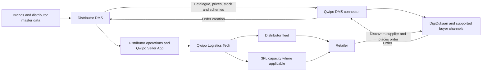

# Qwipo and DigiDukaan product understanding

Qwipo provides technology that helps FMCG brands, distributors and retailers work through their existing distribution relationships. DigiDukaan captures retailer orders digitally. Qwipo's seller and integration tools connect those orders to distributor operations, while Logistics Tech helps plan and monitor fulfillment. This is the consistent business model across the supplied documents. [S1 pp. 1–2; S2 pp. 1–3; S4; S7 slides 3–4]

The recommended website should introduce Qwipo as the company and DigiDukaan as its named commerce product. Brands and distributors are the primary audience, as confirmed by the user. The main outcome is a qualified partnership or demo enquiry.

The documents use DigiDukaan, Digidukaan and Digidukan, while the request uses DigiDukan. This brief uses **DigiDukaan** provisionally because it is prevalent in the documents and matches the inspected Google Play listing. Confirm the formal product name before design finalization.

## Business problem

A retailer may need stock on Tuesday even though the distributor's salesperson visits on Friday. The shop may miss schemes or new products, and the distributor may never receive that order. Giving the retailer a digital channel solves order capture, but delivery is still difficult when new orders arrive across areas outside the regular delivery beat. Qwipo addresses both the ordering gap and the operational work needed to fulfill demand. This is an illustrative scenario, not a measured customer case. [S1 pp. 3–7; S6 slide 1]

For a brand, the opportunity is to improve engagement with outlets that field teams cannot visit often. For a distributor, it is to receive orders between visits and manage delivery capacity more efficiently. For a retailer, it is to see available products and schemes and order through authorized distributors without waiting for the next visit. [S2 pp. 2–3; S6]

## Product and capability map

| Component | User | Role | Evidence boundary |
|---|---|---|---|
| DigiDukaan | Retailers and kiranas; the broader operation also includes HoReCa | Multi-brand/distributor discovery, catalogues, schemes and ordering | Supported proposition; availability depends on geography, distributor and retailer relationship |
| Qwipo Seller App | Distributors and wholesalers | Receive orders and manage fulfillment | Shown in ecosystem; detailed current functionality is not fully specified |
| DMS connector | Enterprise and distributor technology teams | Exchange catalogue, inventory, pricing, schemes, orders and status | Architecture is in a draft; supported vendors and actual deployment status need confirmation |
| Logistics Tech | Brands, distributors, operations managers and driver/helper teams | Route/load planning, tracking, delivery confirmation, aging, returns and analytics | Historical ITC pilot evidence plus a proposed packaging matrix |
| Fintech credit | Eligible retailers and lending partners | Additional working-capital option | Explicitly coming soon in the sales guide; not Qwipo-originated guaranteed credit |
| White-label B2B commerce SaaS | Individual FMCG brands | Brand-specific ordering and proposed AI capabilities | Strategic product direction; production readiness unestablished |

The first launch should feature DigiDukaan and Logistics Tech. Explain the connector under integrations and the Seller App within the distributor journey. Reserve the other offerings for later publication once availability is confirmed.

## How the ecosystem works

This is a business-level synthesis of S5 slide 1 and S7 slide 4, not a verified production architecture. Exact system handoffs and support for each integration remain implementation-specific. It depicts Qwipo's data and coordination role; goods continue through the relevant sellers and fulfillment partners.

## What the operating model preserves

- **Distributor relationships:** retailers buy through participating distributors serving their area.
- **Master-data ownership:** the DMS remains the source of truth; the connector does not replace it.
- **Existing payment terms:** the sales guide preserves existing cash/credit relationships. New retailer credit remains the distributor's decision.
- **Fleet flexibility:** the ecosystem describes distributor vehicles as the primary fulfillment path with external capacity when needed.
- **Order conditions:** normal beat delivery and approved next-day delivery are distinct choices. [S5 slide 1; S6; S7 slide 4]

The documents describe Qwipo as asset-light and not holding inventory in this model. They do not fully define seller-of-record responsibilities, all invoicing arrangements, settlement flows, fees or liability across every service. Those details should not be invented in website FAQs.

## Why an enterprise would consider Qwipo

| Audience | Core concern | Relevant Qwipo capability | Useful proof |
|---|---|---|---|
| Brand sales or distribution leader | Underserved outlets and inconsistent engagement | DigiDukaan ordering and scheme visibility through distributor networks | Adoption and reorder data from an agreed pilot |
| Brand operations leader | Cost and delivery visibility across distributors | Logistics planning and operational reporting | Comparable fleet, distance, delivery-aging and returns measures |
| Distributor owner | Missed orders and delivery cost | Digital order capture, own-fleet planning and driver tools | A demonstration using representative daily workflows |
| Enterprise technology team | Integration effort and data ownership | DMS connector with distributor scoping and configured synchronization | Supported integration list, complete data contract and implementation checklist |

The source materials support these value propositions. They do not establish numerical sales uplift from DigiDukaan or a universal logistics savings percentage.

## Business model and maturity

The commercial direction combines commerce enablement and enterprise software, with logistics subscriptions/usage charges and possible add-ons. S3 supplies one historical pilot price and an enterprise pricing proposal; it does not establish a current universal tariff. The seven files do not provide a complete, reconciled revenue model or prove that every proposed revenue stream is active.

The strongest evidence of operating maturity is the Hyderabad commerce operation and detailed March–April 2026 logistics pilot. Expansion, brand pipelines, future AI products, funding discussions and Paytm integration must retain their stated status. “Target”, “in progress”, “coming soon”, “pilot” and “live” are materially different.

## Public identity and external checks

The existing [Qwipo homepage](https://qwipo.com/) was inspected in a browser on 26 October 2026. It leads with broad MSME-marketplace positioning and categories beyond FMCG, with general services and contact navigation. It uses the purple Qwipo mark. The proposed site's focus is an editorial decision based on the supplied documents and the selected audience; it is not a claim that the existing businesses have ceased.

The inspected [Google Play listing](https://play.google.com/store/apps/details?id=com.qwipo.b2b) identifies the app as Qwipo DigiDukaan and provides a verified Android destination. Its full page showed 50K+ downloads and an update dated 13 October 2026; search snippets showed older figures. Treat store downloads separately from company-reported downloads and active retailers. The developer is listed as Xavica / XAVICA SOFTWARE SOLUTIONS PRIVATE LIMITED; confirm the correct contracting entity for the new site.

[ONDC's DigiDukaan page](https://www.ondc.org/pages/digidukaan.html) supports the broader initiative's unified procurement and existing-distributor model. Its network figures are ecosystem figures, not automatically Qwipo figures. ONDC participation should not be presented as government ownership of Qwipo or a blanket endorsement of every commercial claim.

## Practical conclusion for the website

Lead with a plain enterprise proposition: **Help your distributor network receive retailer orders and plan fulfillment digitally.** Show the two principal products, explain how they connect with current distributor operations, and invite a discussion about the prospect's network or pilot.

Use genuine app screens and operational visuals. Build trust with reconciled, dated evidence and a clear implementation process. Keep the public story focused enough that a brand leader or distributor owner can understand Qwipo and choose a next step within the first page.

See [the complete document review](02-document-review.md), [the website plan](03-website-plan.md), and [claims and decisions](04-claims-and-decisions.md).
